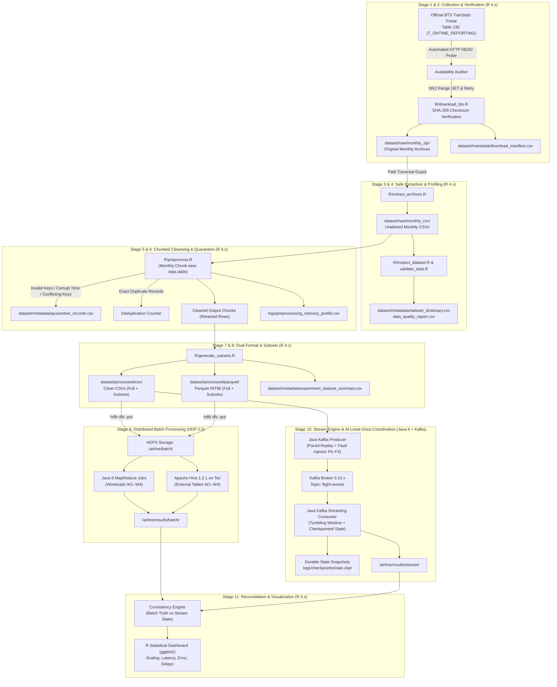

# Implementation & Execution Plan: Airline Delay Analytics (Version 3.1)

## Performance and Consistency of Batch and Stream Processing for Airline Delay Analytics: A Hadoop MapReduce, Hive and Kafka Study with R Visualization

**Document Version:** 3.1 (Final Technical Revision)  
**Author:** Senior Data Engineer & Big Data Research Assistant  
**Target Environment:** Windows 11 Host, Hortonworks Data Platform (HDP) Sandbox 2.5 (Hadoop 2.7.3, Apache Hive 1.2.1, Apache Tez 0.7.0, Apache Kafka 0.10.x, Java 8), R 4.x Runtime  
**Project Workspace:** `C:\Users\DELL\.gemini\antigravity\scratch\Airline-Delay-Analytics`  

---

## 1. Summary of Changes: Version 3.0 to Version 3.1

| Correction Category | Version 3.0 Specification | Version 3.1 Final Correction |
| :--- | :--- | :--- |
| **Kafka Delivery Semantics** | Claimed "Exactly-Once semantics". | Corrected to **At-Least-Once Delivery with Idempotent State Updates & Output Publication**. Fully documents failure modes and eliminates unsupported Kafka 0.10.x transaction claims. |
| **Checkpoint Coordination** | Generic state and offset flush. | Formulated a **Crash-Safe 4-Phase Checkpoint Protocol**: coordinates aggregation buckets, durable deduplication store, partition-wise offsets, and atomic temporary-file renaming. Documents crash recovery before and after checkpoint boundary. |
| **Timestamp Semantics** | Undifferentiated `event_time`. | Renamed to `sched_dep_timestamp`. Explicitly distinguishes **Local-Clock-Hour Analysis** (airport diurnal congestion) from **UTC Normalized Analysis** (using airport IANA timezone reference). Prohibits false claims of globally synchronized event-time windows on naive local clocks. |
| **R Memory Management** | Claimed "guaranteed 4 GB RAM". | Removed unsupported guarantee. Enforces **strict monthly chunk-wise processing** (`fread(skip, nrows)`), disk-buffered intermediate outputs, and automated memory telemetry logging via `gc()` profiling. Prohibits accumulating 12 months in RAM. |
| **Stratified Sampling** | Conflated proportional and equal sampling. | Mathematically formalized **Proportional Monthly Sampling** ($n_m = \text{round}(N \times R_m / R_{\text{total}})$) preserving seasonal distributions, and separated **Equal Monthly Allocation** ($N/12$) as an independent robustness experiment. |
| **Validation & Test Suite** | Basic unit tests. | Expanded test suite to include **Monthly Row Conservation**, **Kafka Partition Rebalance & Crash Recovery**, **Output Idempotency**, **DST/Timezone Conversion**, and **Hive vs MapReduce Parity**. |
| **Software Verification** | Assumed versions based on product name. | Introduced `scripts/discover_environment.sh` and host checklist to inspect actual installed binaries (`hadoop`, `hive`, `tez`, `kafka`, `java`, `R`). |
| **BTS Availability** | Assumed 12 months available. | Enforced automated HTTP HEAD pre-download probing to audit available vs unreleased 2025 monthly archives without fabricating data. |

---

## 2. Technology Stack & Language Responsibilities

```
+-------------------------------------------------------------------------------------------------+
|                                 STRICT ARCHITECTURAL ASSIGNMENTS                                |
+------------------------------------+------------------------------------+-----------------------+
| Subsystem                          | Technology                         | Language / Tools      |
+------------------------------------+------------------------------------+-----------------------+
| Data Collection & Ingestion        | R 4.x Pipeline                     | R (httr2, digest)     |
| Extraction & Quality Validation    | R 4.x Pipeline                     | R (data.table, dplyr) |
| Chunked Cleaning & Deduplication   | R 4.x Streaming Cleaner            | R (data.table, arrow) |
| Parquet & Clean CSV Generation     | R 4.x Export Engine                | R (arrow, data.table) |
| Experimental Subsets Generation    | R 4.x Subsetting Engine            | R (data.table, arrow) |
| Distributed Master Storage         | Hadoop HDFS (HDP 2.5)              | HDFS Shell / WebHDFS  |
| Distributed Batch Processing       | Apache Hadoop MapReduce            | Java 8 (MR API)       |
| SQL Analytics & Data Warehousing   | Apache Hive on Tez                 | HiveQL / Beeline      |
| Stream Ingestion & Fault Injection | Apache Kafka (flight-events topic) | Java 8 Kafka Producer |
| Real-Time Stream Analytics         | Custom Windowing Stream Engine     | Java 8 Kafka Consumer |
| Hybrid Reconciliation Layer        | Batch vs Stream Consistency Engine | Java / R              |
| Statistical Analysis & Dashboard   | Visualization Dashboard            | R (ggplot2, tidyverse)|
| Automated Test Suites              | Unit, Parity & Integration Tests   | R (testthat), JUnit   |
+------------------------------------+------------------------------------+-----------------------+
```

> [!CAUTION]
> **Strict Prohibition:** Python, PySpark, Apache Spark, Spark SQL, Spark Structured Streaming, and all machine learning frameworks/libraries are strictly prohibited. R 4.x is the exclusive data engineering and statistical language. Java 8 is the exclusive MapReduce and Kafka engine language. HiveQL is the exclusive SQL dialect.

---

## 3. Environment & Software Version Verification

Before executing workloads on HDP 2.5, an automated discovery script verifies the actual installed binaries:

```bash
# scripts/discover_environment.sh (Executed inside HDP 2.5 Sandbox)
echo "=== Hadoop Version ==="
hadoop version | head -n 2

echo "=== Java Runtime ==="
java -version 2>&1 | head -n 2

echo "=== Hive Version ==="
hive --version 2>&1 | head -n 2

echo "=== Tez Version ==="
ls /usr/hdp/current/tez-client/lib/tez-api-*.jar 2>/dev/null || echo "Tez jars located in default HDP path"

echo "=== Kafka Broker Version ==="
ls /usr/hdp/current/kafka-broker/libs/kafka_*.jar 2>/dev/null || find / -name "kafka_*.jar" 2>/dev/null | head -n 1
```

**Known Compatibility Constraints:**
1. **Hadoop 2.7.3 & Java 8:** Java MapReduce jobs must be compiled with `-source 1.8 -target 1.8` using Hadoop 2.7.3 client libraries.
2. **Hive 1.2.1000 on Tez 0.7.0:** Hive 1.2.1 relies on `parquet-hadoop 1.8.1`. Writing Parquet files with modern logical timestamp types causes Hive runtime decoding failures. R `arrow` must write Parquet files using **Parquet Format 1.0** and **INT96 physical timestamps** (or ISO-8601 strings).
3. **Cleaned CSV Interchange Fallback:** Cleaned CSV datasets are produced in parallel with Parquet for all subsets. If Hive 1.2.1 encounters Parquet SerDe anomalies, the pipeline falls back to Hive external tables on CSV (`ROW FORMAT DELIMITED FIELDS TERMINATED BY ','`).
4. **Kafka 0.10.x Java API:** The Java Kafka Producer and Consumer strictly utilize Kafka 0.10.x client APIs, avoiding calls to methods introduced in Kafka 0.11+ or 2.x/3.x.

---

## 4. End-to-End System Architecture



---

## 5. Mathematical Formulations & Data Engineering Rules

### 5.1 Scheduled Time Conversion, Rollover & Timezone Semantics
BTS `CRSDepTime` is an integer in local airport military time format (`0` to `2400`):
$$\text{sched\_hour} = \lfloor \text{CRSDepTime} / 100 \rfloor, \quad \text{sched\_min} = \text{CRSDepTime} \pmod{100}$$

**Time Conversion Rules:**
1. **Normal Case ($0 \le \text{sched\_hour} \le 23 \land 0 \le \text{sched\_min} \le 59$):**
   $$\text{sched\_dep\_local} = \text{as.POSIXct}(\text{flight\_date}) + (\text{sched\_hour} \times 3600) + (\text{sched\_min} \times 60)$$
   $$\text{sched\_dep\_hour} = \text{sched\_hour}$$
2. **2400 Midnight Rollover ($\text{CRSDepTime} == 2400$):**
   `2400` represents midnight at the conclusion of the scheduled flight date. It is rolled forward to the beginning of the next calendar day:
   $$\text{sched\_dep\_local} = \text{as.POSIXct}(\text{flight\_date}) + 86400 \quad (\text{00:00:00 of date} + 1)$$
   $$\text{sched\_dep\_hour} = 0$$
3. **Corrupt / Invalid Values:**
   Records with $\text{sched\_min} \ge 60 \lor \text{sched\_hour} > 24 \lor \text{CRSDepTime} < 0 \lor \text{is.na}(\text{CRSDepTime})$ are rejected and routed to `dataset/metadata/quarantine_records.csv` under reason `INVALID_SCHEDULED_TIME`.
4. **Timezone Semantics (Local Airport Clock vs UTC):**
   - **Local-Clock-Hour Analysis (Primary Scope for Workload W2 & W3):** BTS reports all times in local airport wall-clock time. `sched_dep_local` reflects the operational hour at the origin airport. Workload W3 is explicitly defined as a **local diurnal congestion analysis** across US airports rather than a globally synchronized physical window.
   - **UTC Normalization (Optional Synchronized Stream Replay):** Where origin airport IATA codes map reliably to IANA timezones (e.g., `ORD` $\to$ `America/Chicago`, `JFK` $\to$ `America/New_York`, `DEN` $\to$ `America/Denver`, `LAX` $\to$ `America/Los_Angeles`), `sched_dep_utc` is computed accounting for Daylight Saving Time (DST) transitions. The research documentation explicitly reports whether W3 is evaluated on local clock windows or UTC synchronized windows.

### 5.2 Deterministic Structured Keys & Duplicate Classification
- **Raw Row Hash:**
  $$\text{raw\_row\_hash} = \text{digest}(\text{raw\_csv\_row\_string}, \text{algo} = \text{"sha256"})$$
- **Structured Flight Key:**
  $$\text{structured\_key} = \text{flight\_date} \parallel \text{airline} \parallel \text{flight\_num} \parallel \text{origin} \parallel \text{dest} \parallel \text{sprintf}("\%04d", \text{crs\_dep})$$
- **Deterministic Event ID:**
  $$\text{event\_id} = \text{digest}(\text{structured\_key}, \text{algo} = \text{"sha256"})$$

**Duplicate Classification Matrix:**

| Duplicate Type | Definition | Pipeline Action |
| :--- | :--- | :--- |
| **Exact Duplicate** | All raw row fields are 100% identical. | Keep 1 primary instance; log redundant rows to `duplicates_removed`. |
| **Conflicting Duplicate** | Identical `structured_key` but differing delay values, cancellation flags, or diversion status. | **NEVER SILENTLY DELETE.** Quarantine all conflicting occurrences in `quarantine_records.csv` under reason `CONFLICTING_KEY_DUPLICATE`. |
| **Legitimate Multi-leg Flight** | Same airline and flight number on the same date, but distinct route legs (e.g. ORD $\to$ DFW, then DFW $\to$ LAX). | Preserved as separate valid events because `origin` and `dest` form part of `structured_key`. |

### 5.3 Mutually Exclusive Monthly & Annual Row Accounting
For every individual month $m \in \{1 \dots 12\}$ and for the entire annual dataset:
$$N_{\text{raw}, m} = N_{\text{retained}, m} + N_{\text{quarantine}, m} + N_{\text{exact\_duplicates}, m}$$
$$N_{\text{raw, total}} = \sum_{m=1}^{12} N_{\text{raw}, m} = \sum_{m=1}^{12} N_{\text{retained}, m} + \sum_{m=1}^{12} N_{\text{quarantine}, m} + \sum_{m=1}^{12} N_{\text{exact\_duplicates}, m}$$

### 5.4 Zero-Imputation Policy & Delay Validity Flags
- **Zero Imputation:** Missing delay values for cancelled and diverted flights are **never imputed**.
- **Explicit Validity Flags:**
  $$\text{is\_valid\_arr} = \begin{cases} 1 & \text{if } \text{cancelled} == 0 \land \text{diverted} == 0 \land \text{arr\_delay IS NOT NA} \\ 0 & \text{otherwise} \end{cases}$$
  $$\text{is\_valid\_dep} = \begin{cases} 1 & \text{if } \text{cancelled} == 0 \land \text{dep\_delay IS NOT NA} \\ 0 & \text{otherwise} \end{cases}$$
- **Extreme Delays:** Arrival delays outside $[-120, 3000]$ minutes are logged in `data_quality_report.csv` but preserved without alteration.

---

## 6. R Chunked Memory Management & Telemetry

To operate stably within 16 GB host RAM, the R pipeline enforces:
1. **No Monolithic Loading:** The 12 monthly CSVs are never loaded concurrently into memory.
2. **Chunk-wise Ingestion:** Monthly CSVs exceeding 500,000 rows are read in sequential chunks of 250,000 rows via `data.table::fread(..., skip = offset, nrows = chunk_size)`.
3. **Incremental Disk Buffering:** Cleaned chunks are written directly to monthly partition files (`dataset/processed/parquet/month=YYYY_MM/chunk_X.parquet` and CSV).
4. **Explicit Garbage Collection:** Following each chunk, intermediate objects are unbound (`rm()`) and memory reclaimed via `gc()`.
5. **Memory Telemetry Profile:** R logs resident memory allocation before and after every monthly processing stage to `logs/preprocessing_memory_profile.csv` (recording Vcells, Ncells, and peak megabytes used).

---

## 7. Experimental Subsets & Stratified Robustness Dataset

1. **Nested Chronological Subsets:**
   Extracted from the chronologically sorted cleaned dataset (`flights_full`):
   - `flights_100k` (First 100,000 records)
   - `flights_500k` (First 500,000 records)
   - `flights_1m` (First 1,000,000 records)
   - `flights_5m` (First 5,000,000 records)
   - `flights_full` (All valid retained records)
2. **Proportional Monthly Stratified Dataset (`flights_1m_proportional`):**
   Preserves natural seasonal flight distributions (summer peaks, holiday volumes). For total target $N = 1,000,000$:
   $$n_m = \text{round}\left(N \times \frac{R_m}{R_{\text{total}}}\right), \quad \text{where } R_m = \text{valid retained rows in month } m$$
   Samples $n_m$ records from each month using a fixed random seed (`set.seed(42)`).
3. **Equal Monthly Allocated Dataset (`flights_1m_equal` - Separate Robustness Experiment):**
   Samples exactly $\lfloor N / 12 \rfloor = 83,333$ records uniformly from each of the 12 months to isolate seasonal volume bias.
4. **Coverage Audit (`dataset/metadata/experiment_dataset_summary.csv`):**
   Logs subset ID, record count, calendar start, calendar end, total days spanned, and sampling design.

---

## 8. Downstream Analytical Workloads (W1 to W4)

All workloads compute strictly **additive measures**, ensuring exact mathematical equivalence between batch and stream outputs:

| Workload | Business Question | Grouping Keys | Additive Measures Computed |
| :--- | :--- | :--- | :--- |
| **W1** | Carrier flight counts, cancellations, and arrival delay | `airline` | `n_flights = COUNT(*)`, `n_cancelled = SUM(cancelled)`, `n_valid_arr = SUM(is_valid_arr)`, `sum_arr_delay = SUM(IF(is_valid_arr=1, arr_delay, 0))` |
| **W2** | Departure delay by origin airport and scheduled hour | `origin`, `sched_dep_hour` | `n_valid_dep = SUM(is_valid_dep)`, `sum_dep_delay = SUM(IF(is_valid_dep=1, dep_delay, 0))` |
| **W3** | Tumbling-window delay across time | `window_start` (1-hour) | `n_flights = COUNT(*)`, `n_valid_arr = SUM(is_valid_arr)`, `sum_arr_delay = SUM(IF(is_valid_arr=1, arr_delay, 0))` |
| **W4** | Route delay summary (top delayed routes) | `origin`, `dest` | `n_valid_arr = SUM(is_valid_arr)`, `sum_arr_delay = SUM(IF(is_valid_arr=1, arr_delay, 0))` |

---

## 9. Java Kafka Streaming Engine: At-Least-Once Delivery & Crash-Safe Checkpointing

### 9.1 Delivery Guarantee & Failure Modes
Kafka 0.10.x does not support modern transactional producer semantics (`sendOffsetsToTransaction`). Therefore, the Java streaming engine implements an **At-Least-Once Delivery Architecture with Idempotent State Updates & Idempotent Output Publication**:

```
+-----------------------------------------------------------------------------------+
|                        AT-LEAST-ONCE FAILURE & RECOVERY MATRIX                     |
+-----------------------------------+-----------------------------------------------+
| Failure Scenario                  | Engine Recovery Mechanism                     |
+-----------------------------------+-----------------------------------------------+
| Crash before checkpoint write     | In-memory updates discarded. Consumer reloads |
|                                   | last committed checkpoint. Offsets replay from|
|                                   | last committed Kafka offset. Zero data loss.  |
+-----------------------------------+-----------------------------------------------+
| Crash after checkpoint write but  | Checkpoint contains newer state than broker   |
| before consumer.commitSync()      | offset. On restart, consumer reads older      |
|                                   | offset; durable deduplication store drops     |
|                                   | already-processed event_ids within watermark. |
|                                   | State remains exact. No double-counting.      |
+-----------------------------------+-----------------------------------------------+
| Consumer Partition Rebalance      | ConsumerRebalanceListener flushes active state|
|                                   | and synchronously commits offsets before      |
|                                   | partitions are revoked.                       |
+-----------------------------------+-----------------------------------------------+
```

### 9.2 Crash-Safe 4-Phase Checkpoint Coordination Protocol
Every checkpoint cycle (e.g. every 2 seconds or after $B$ events):
1. **Phase 1 (Pause Ingestion):** Ingestion loop temporarily pauses message consumption.
2. **Phase 2 (Durable State Serialization):**
   - Active tumbling window aggregation buckets (`Map<WindowKey, AdditiveMeasures>`) and the active deduplication key store (seen `event_id` hashes within watermark horizon) are serialized to a temporary checkpoint file:
     `logs/checkpoints/state_ckpt_<batch_id>.tmp`
   - File handle is flushed and forced to disk via `FileOutputStream.getFD().sync()`.
   - Atomic rename: `state_ckpt_<batch_id>.tmp` $\to$ `state_ckpt_current.snap`.
3. **Phase 3 (Synchronous Offset Commit):**
   - Kafka partition offsets (`Map<TopicPartition, OffsetAndMetadata>`) are committed to Kafka brokers via `consumer.commitSync()`.
4. **Phase 4 (Idempotent Output Publication):**
   - Emitted window results are written to partition-specific sink files using deterministic versioned naming:
     `results/stream/w1_batch_<batch_id>.parquet.tmp` $\to$ atomic rename to `.parquet`.
   - Ingestion resumes.

---

## 10. Comprehensive Automated Test Strategy

| Test Identifier | Test Scope | Implementation | Success Verification Criteria |
| :--- | :--- | :--- | :--- |
| **TEST-01** | 2400 Midnight Rollover | R `testthat` | `crs_dep == 2400` increments `flight_date` by 1 day, sets time to `00:00:00` and `sched_dep_hour = 0`. |
| **TEST-02** | Time Validation & Quarantine | R `testthat` | Corrupt minutes ($\ge 60$) or hours ($>24$) are routed to `quarantine_records.csv`. |
| **TEST-03** | Duplicate Classification | R `testthat` | Exact duplicates counted in `duplicates_removed`; conflicting keys routed to quarantine. |
| **TEST-04** | Delay Validity & Zero Imputation | R `testthat` | Cancelled/diverted flights retain `NA` delays; `is_valid_arr` and `is_valid_dep` equal 0. |
| **TEST-05** | Monthly Row Conservation | R `testthat` | $N_{\text{raw}, m} == N_{\text{retained}, m} + N_{\text{quarantine}, m} + N_{\text{exact\_duplicates}, m}$ holds for all 12 months. |
| **TEST-06** | Parquet / CSV Aggregate Parity | R `testthat` | Columnar Parquet and Clean CSV yield identical counts and delay sums. |
| **TEST-07** | Timezone Conversion & DST | R `testthat` | Airport IANA timezone conversion properly handles March/November DST transitions. |
| **TEST-08** | Output Idempotency | R / Java | Multiple executions of the export script yield byte-identical Parquet/CSV records. |
| **TEST-09** | Hive 1.2.1 DDL & Query Parity | HDP 2.5 / Beeline | Hive external tables execute W1–W4 queries on Parquet without INT96 timestamp exceptions. |
| **TEST-10** | Hive vs MapReduce Parity | HDP 2.5 Sandbox | Java MapReduce and HiveQL output tables match key-by-key with zero aggregate discrepancy. |
| **TEST-11** | Kafka Rebalance & Crash Recovery | Java JUnit | Consumer killed before and after checkpoint commit recovers with zero lost or duplicated records. |
| **TEST-12** | Hybrid Consistency Verification | Java / R | Evaluates streaming window state against batch ground truth, computing exact-key % and error. |

---

## 11. Phase-Wise Execution Instructions

### Phase 1: Environment Discovery & Workspace Verification
1. Run `scripts/discover_environment.sh` on HDP 2.5 to verify installed versions of Hadoop, Hive, Tez, Kafka, and Java.
2. Verify host R runtime and install required R packages:
   ```r
   install.packages(c("httr2", "data.table", "arrow", "dplyr", "lubridate", "digest", "jsonlite", "ggplot2", "testthat", "logger"))
   ```
3. Verify workspace directories under `Airline-Delay-Analytics/`.

### Phase 2: Official BTS Portal Verification & Resilient Download
1. Run `R/download_bts.R` probe:
   - Issue automated HTTP HEAD requests to `https://transtats.bts.gov/PREZIP/` for all 12 months of 2025.
   - Record available vs unpublished months transparently in `dataset/metadata/download_manifest.csv`.
2. Download verified monthly archives with HTTP Range resumption and SHA-256 validation.

### Phase 3: Safe Extraction, Inspection & Data Profiling
1. Execute `R/extract_archives.R` with path traversal guards.
2. Execute `R/inspect_dataset.R` to profile columns, encoding, and types.
3. Generate `dataset_dictionary.csv` and `monthly_summary.csv`.

### Phase 4: Chunked Preprocessing, Flags & Quarantine
1. Execute `R/validate_data.R` and `R/preprocess.R`.
2. Clean data month-by-month in chunks via `data.table`.
3. Route invalid and conflicting records to `dataset/metadata/quarantine_records.csv`.
4. Log memory profile to `logs/preprocessing_memory_profile.csv`.
5. Output cleaned CSV and Hive-compatible Parquet files.

### Phase 5: Experimental Subsets & Automated Testing
1. Execute `R/generate_subsets.R` to produce nested chronological subsets (100K, 500K, 1M, 5M) and stratified datasets.
2. Execute `tests/testthat.R` running automated test suites TEST-01 through TEST-08.
3. Execute Hive 1.2.1 compatibility smoke test on HDP 2.5.

### Phase 6: Distributed Batch Benchmarks (HDP 2.5 Sandbox)
1. Load cleaned datasets into HDFS (`/airline/batch/csv/` and `/airline/batch/parquet/`).
2. Run Java MapReduce jobs (W1–W4) across all subsets, recording wall-clock time, CPU, and memory.
3. Run Hive on Tez queries (W1–W4) via Beeline, recording query execution times.
4. Run TEST-10 verifying key-by-key parity between MapReduce and Hive outputs.

### Phase 7: Real-Time Streaming & Fault Injection (Java + Kafka)
1. Launch Java Kafka Producer replaying cleaned records across offered rates ($100$ to $5000\text{ events/s}$) under fault scenarios $F_0$ through $F_4$.
2. Launch Java Kafka Streaming Consumer with crash-safe checkpointing protocol.
3. Run TEST-11 simulating process kill and recovery.
4. Record latency percentiles ($p50, p95, p99$) and throughput.

### Phase 8: Reconciliation & Statistical Visualization Dashboard (R)
1. Execute hybrid reconciliation comparing streaming results against batch ground truth (TEST-12).
2. Execute R visualization scripts generating research publication figures:
   - Figure 1: Batch scaling execution time (MapReduce vs Hive on Tez).
   - Figure 2: Streaming throughput and latency saturation curves.
   - Figure 3: Consistency error under late and duplicate fault scenarios.
   - Figure 4: Airline and hourly delay distributions.
